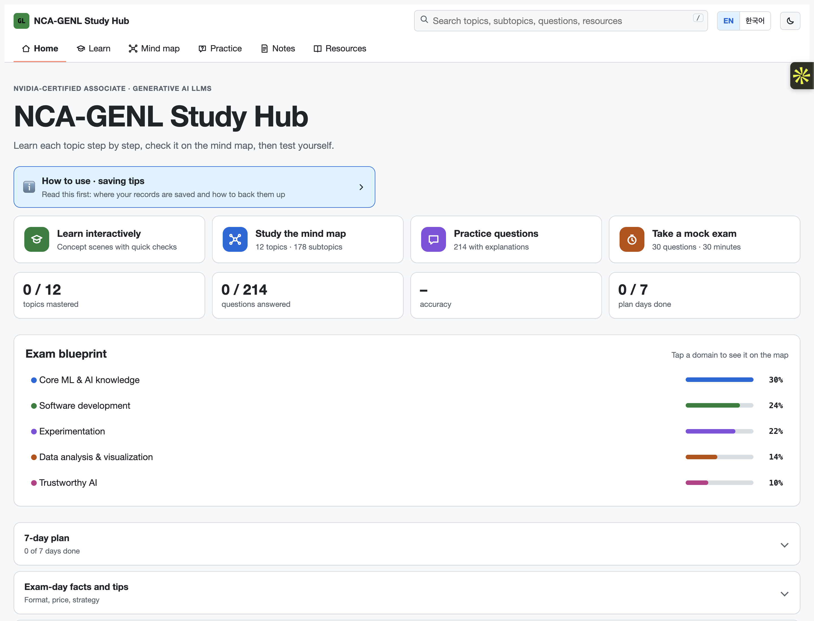

# NCA-GENL Study Hub

A single-file, offline study app for the **NVIDIA-Certified Associate: Generative AI LLMs (NCA-GENL)** exam.

## Live preview

[**Open the Study Hub in your browser**](https://woojinjeon820-ui.github.io/nca-genl-study-hub/) · No download or installation required.

## Why

I built this for colleagues who are new to AI and preparing for the NCA-GENL exam. It turns the official syllabus into one beginner-friendly place to learn, practice and track progress.

## How to use

**Try it in your browser:** https://woojinjeon820-ui.github.io/nca-genl-study-hub/

Or download `index.html` and double-click it. It runs in Chrome, Edge or Whale with no install, no server and no internet.

## What's inside

- **Learn**: 12 exam topics, each taught as step-by-step scenes with concept cards, 24 interactive tools (gradient descent, attention, sampling, LoRA, confusion matrix and more) and quick checks.
- **Mind map**: every topic and its 178 subtopics, with animated focus on whatever you select.
- **Practice**: 214 questions with explanations, filters, and a timed 30-question mock exam.
- **Wrong-answer notes**: missed questions are saved automatically, with memos and "retry only my mistakes".
- **Progress backup**: all records stay in your browser (localStorage). Export and import a JSON backup to move between devices.
- Korean / English switch and light / dark mode.

## Privacy

Nothing is sent anywhere. All data lives in your own browser.

## Built with

Plain HTML, CSS and JavaScript in one file. No frameworks, libraries or external requests.

